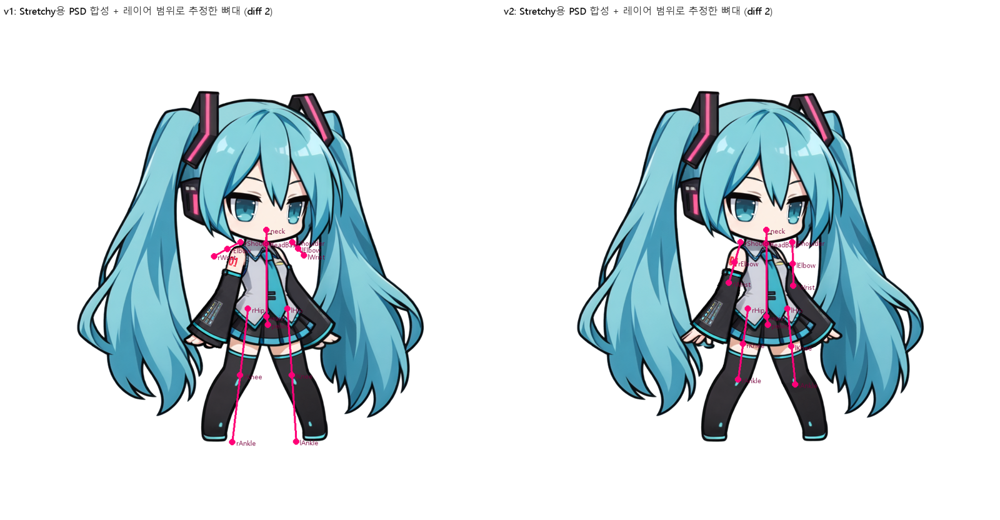
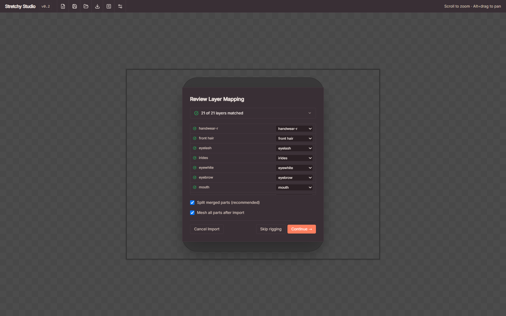
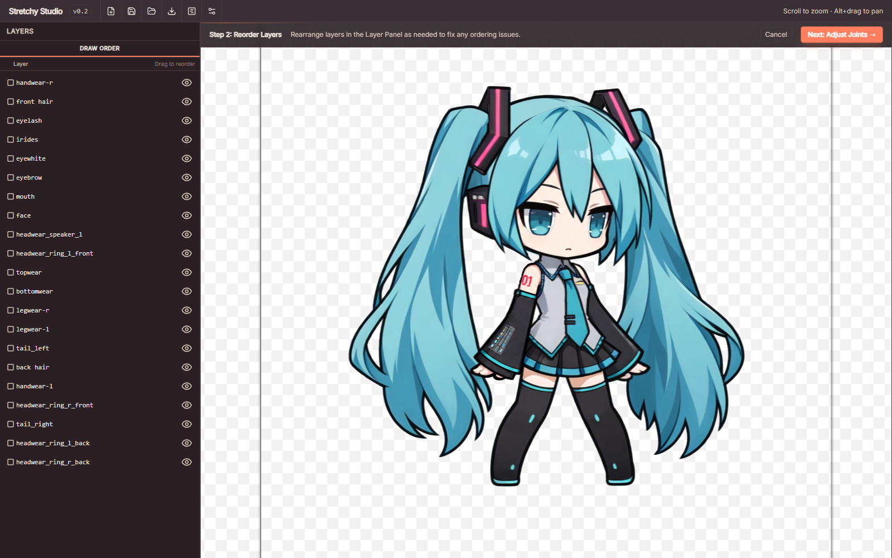
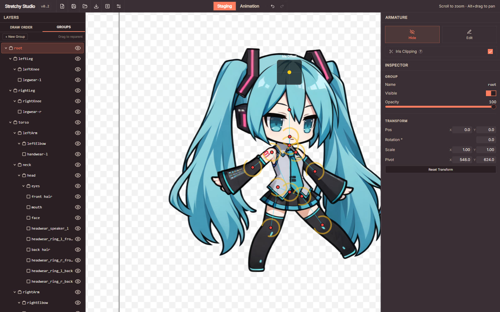
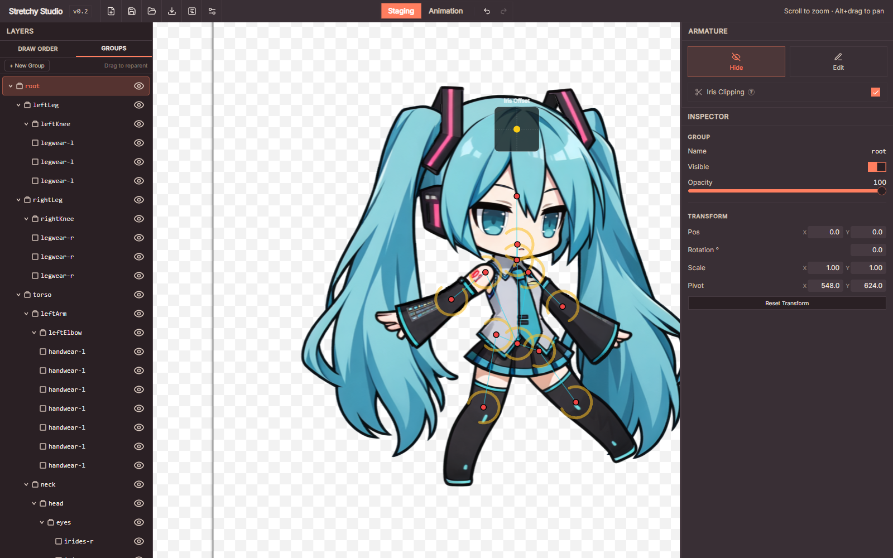
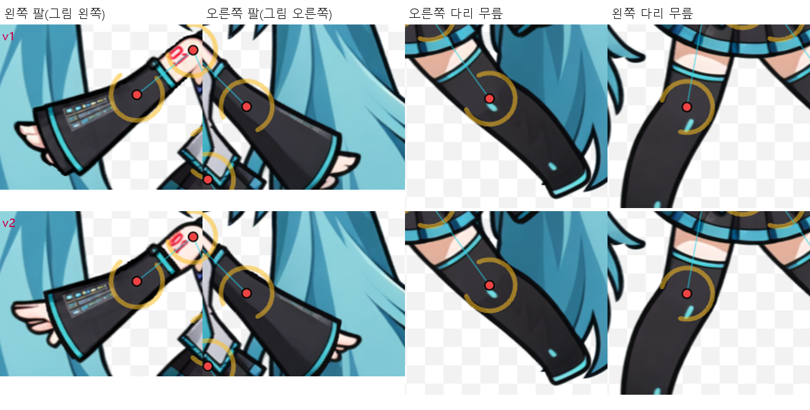

# Stretchy Studio 시험 (2026-11-26)

[Stretchy Studio](https://github.com/MangoLion/stretchystudio)(See-through 결과를 리깅·애니메이션하는 오픈소스 도구)에
miku v1(21레이어)·v2(45레이어) PSD를 넣어 봤어요. 웹 편집기 https://editor.stretchy.studio 를 브라우저 자동화로 열어 화면을 찍었어요.

## 넣은 파일
`miku_v1_stretchy.psd`, `miku_v2_stretchy.psd` (`export_stretchy.py`로 만듦, 이름 대응표는 같은 이름의 `.json`)

원래 PSD를 그대로 넣으면 안 되는 이유가 두 가지 있어서 Stretchy용으로 따로 만들었어요.
1. **원래 PSD는 레이어가 모두 1024×1024 전체 크기**예요. Stretchy는 레이어 범위로 뼈 위치를 추정해서 → 레이어를 그림 범위로 잘라 저장(위치는 그대로).
2. **Stretchy 안의 좌우 기준이 서로 달라요.**
   - 레이어를 좌우로 나누는 기능은 그림 왼쪽을 `-l`이라고 불러요(우리와 같은 기준).
   - 뼈대는 캐릭터 본인의 왼쪽, 즉 정면 그림에서는 그림 오른쪽에 `leftArm`을 둬요.
   - 우리 이름 그대로면 팔다리가 반대쪽에 붙어요. Stretchy의 뼈대 추정을 따라 그려 보니 다리가 X자로 엇갈렸어요.
   - 그래서 Stretchy용 파일은 **캐릭터 기준**으로 바꿨어요(우리 `_l` → `-r`).
3. 이름은 See-through 태그로 바꿨어요(`front hair`, `back hair`, `handwear-l` …).
   - Stretchy는 이름이 정확히 `handwear-l`인 레이어만 왼팔 뼈에 붙여요.
   - 그래서 v2의 팔·다리 조각은 모두 같은 이름(`handwear-l/r`, `legwear-l/r`)이에요.
4. 바꿔 끼우는 손·표정 파츠는 넣지 않았어요. 숨긴 레이어까지 모두 가져와서 리깅해 버려요.

## 결과
| 단계 | 결과 |
|---|---|
| 레이어 대응 | v1 **21/21**, v2 **45/45** 자동 인식 ✓ |
| 그리는 순서 | 원래 순서 그대로, 그림도 원본과 같음 ✓ |
| 자동 뼈대 (레이어 범위) | 팔다리가 올바른 쪽에 붙음 ✓. 다만 팔꿈치가 어깨 바로 옆, 무릎이 다리 중간쯤으로 잡혀서 손으로 옮겨야 함 |
| 자동 뼈대 (AI 자세 인식 DWPose) | **실패**: 엉덩이·팔꿈치가 오른쪽 아래 머리카락에, 무릎이 트윈테일 안에 잡힘. 머리가 큰 SD(치비) 체형을 못 잡는 듯 |
| 굽히기 | 기준점을 우리 `rig.json` 테스트 뼈 위치로 옮기고 회전 → v1·v2 모두 **팔꿈치·무릎이 틈 없이 부드럽게 굽음** ✓ |

## 알게 된 것
- **Stretchy는 메시를 변형해서 굽혀요.** 그래서 팔다리가 한 장인 v1도 잘 굽어요. Stretchy에서는 v2의 관절 조각이 꼭 필요하지 않아요.
- **v2가 Stretchy에서 쓸모 있는 부분:** 눈 좌우 분리(한쪽 눈 감기), 손·표정 바꿔 끼우기. 단, 바꿔 끼우기는 Stretchy에 자동으로 들어가지 않아서 따로 연결해야 해요.
- **v2 조각이 쓸모 있는 곳:** 조각을 회전만 시키는 뼈 방식 도구(Spine 등)예요.
- **이 캐릭터는 뼈대를 범위 추정으로 잡고 관절 위치만 손으로 고치는 게 맞아요.** 관절 위치는 우리 `rig.json`의 테스트 뼈 값을 그대로 넣으면 돼요.
