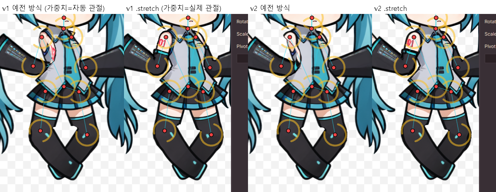
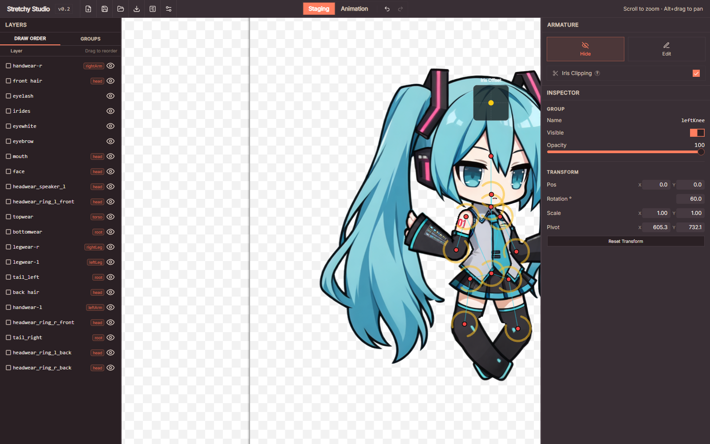
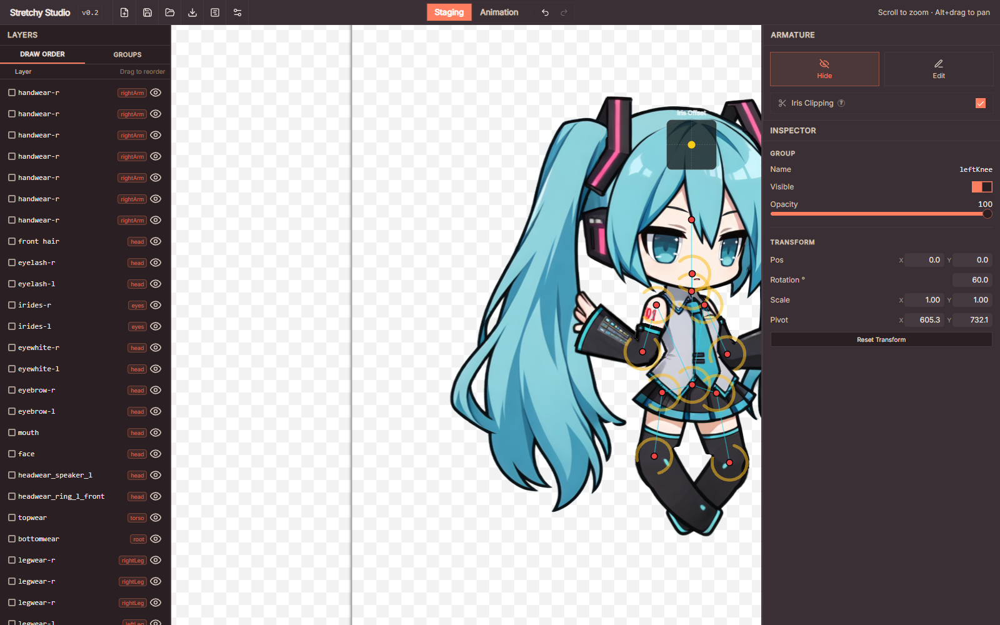

# 관절 위치를 넣은 Stretchy 프로젝트 파일 (.stretch) (2026-11-27)

`miku_v1.stretch`, `miku_v2.stretch`: https://editor.stretchy.studio 에 끌어다 놓으면 **관절 위치가 이미 맞춰진 채로** 열려요.
관절 8개(어깨·팔꿈치·엉덩이·무릎)는 miku `rig.json` 테스트 뼈 위치예요. Stretchy는 캐릭터 기준이라 `left*`가 그림 오른쪽이에요.

## 만드는 순서가 중요해요
Stretchy는 팔다리 메시를 **만들 때의 관절 위치로** 팔꿈치·무릎 가중치를 계산해요(관절 앞뒤 40px에서 서서히 바뀜, `CanvasViewport.jsx`).
가져오기 마법사가 끝나면 이미 메시가 만들어져 있어서, 관절을 나중에 옮기면 가중치는 잘못 잡힌 자동 관절 기준으로 남아요.
그래서 이 순서로 만들었어요 (`st5.py`, 브라우저 자동화):
1. Stretchy용 PSD를 넣고 마법사 진행 (AI 자세 인식 없이)
2. 관절 8개 위치 입력
3. 팔다리 레이어마다 **Remesh**: 가중치를 새 관절 기준으로 다시 계산 (로그 `[Skinning] handwear-l → leftElbow (pivot 602,559)`)
4. Save → Download File

## 굽히는 법: 숫자가 아니라 마우스로
팔꿈치·무릎 메시가 가중치대로 휘는 건 **캔버스에서 관절의 노란 호를 마우스로 끌 때뿐**이에요(`SkeletonOverlay.jsx`).
오른쪽 속성 창 Rotation에 숫자를 넣으면 값은 들어가지만 팔꿈치·무릎은 굽지 않아요(`4_number_input_no_bend.png`).
→ 지난번(7_stretchy_test)에 "팔꿈치·무릎이 굽음"이라고 한 건 **틀렸어요**. 그때 보인 건 어깨·엉덩이 회전이었어요.

## 결과 (호를 끌어서: 그림 왼쪽 팔꿈치 90°, 무릎 ±60°)

| | 팔꿈치 | 무릎 |
|---|---|---|
| 예전 방식 (관절을 나중에 옮김) | 가중치가 어깨 옆 자동 관절 기준이라 **위팔(01 문신)이 찢어지듯 늘어남** | 자동 관절이 실제 무릎과 가까워 비슷하게 굽음 |
| **.stretch** (관절 먼저 → Remesh) | **위팔은 그대로, 실제 팔꿈치에서 꺾임** | 실제 무릎에서 굽음 |

v1(팔다리 한 장)과 v2(조각)는 결과가 거의 같아요. Stretchy는 같은 관절에 붙은 조각을 모두 같은 가중치 방식으로 휘게 해요.

## 메시 변형 정도 설정 (Stretchy 소스 확인)
- **메시 촘촘함:** 파츠마다 또는 전체로 정할 수 있어요(속성 창 Mesh → Settings, 바꾼 뒤 Remesh).

  | 설정 | 기본값 | 뜻 |
  |---|---|---|
  | Grid Spacing | 자동(면적의 제곱근 × 0.08, 6~80) | 안쪽 점 간격. 작을수록 촘촘해서 더 부드럽게 휨 |
  | Edge Points | 자동(면적의 제곱근 × 0.4, 12~300) | 윤곽선에 놓는 점 수 |
  | Edge Padding | 8 | 윤곽 바깥 여유(px) |
  | Alpha Threshold | 5 | 이 투명도보다 진한 픽셀만 메시에 포함 |
  | Smooth Passes | 0 | 윤곽 다듬기 횟수 |
- **직접 휘기:** Edit Mesh → Deform 브러시(크기 5~300, 단단함 0~100)로 점을 밀거나, Adjust로 점을 더하고 뺄 수 있어요.
- **모양 키(shape key):** 휘어진 모양을 저장해 두고 0~1로 섞어요(눈 깜빡임 등).
- **팔꿈치·무릎이 휘는 폭:** 코드에 **40px로 고정**돼 있고 화면 설정은 없어요. 다만 `.stretch` 안 `project.json`에 점마다 가중치(`boneWeights`)가 저장돼서, 파일을 직접 고치면 폭이나 모양을 바꿀 수 있어요.
