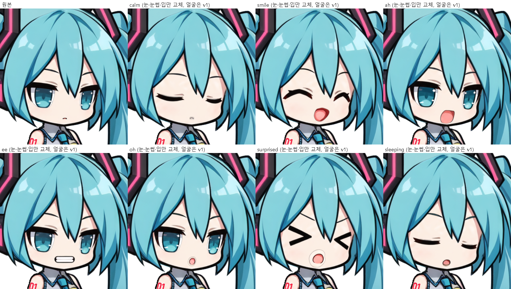
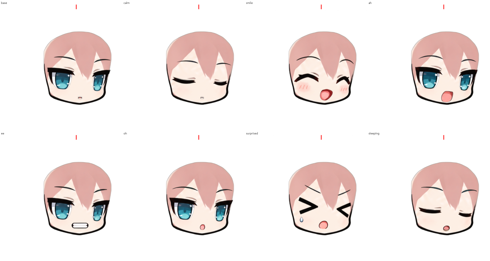

# miku 리깅 작업 확인용 (2026-11-24)

예전 seed·mix 결과는 지우고, 리깅용 분리 작업만 새로 올렸어요. (예전 내용은 git 기록에 남아 있어요.)
모든 레이어 png는 1024 정사각형 페이지 좌표라 확정본 `miku_v1` 레이어에 그대로 겹쳐 쓸 수 있어요.

## 1. 다리 무릎 나누기 — [1_legs](1_legs)
- 사용자가 그은 빨간 선에서 자름. **종아리(shin)가 앞, 허벅지(thigh)가 뒤.**
- 종아리에 둥근 관절 캡(외곽선 없음), 관절 외곽선은 `shin_*_joint_line.png`로 따로: **종아리 뼈에 붙이고, 그리는 순서는 허벅지보다 뒤.**
  → 서 있을 때는 원본과 같고, 굽히면 배경과 닿는 곳에만 외곽선이 보여요.
- 그리는 순서(앞→뒤)와 무릎 회전 중심: `legwear-*/joint.json`

## 2. 표정 편집본 — [2_expr_input](2_expr_input)
원본(`miku_chibi_sprite.png`)에서 표정만 바꾼 7장: calm, smile, ah, ee, oh, surprised, sleeping.
원본과 비교하면 얼굴 밖은 윤곽선 1~2px 흔들림뿐, 얼굴 위치 차이는 1px 안팎.

## 3. 표정 7장 See-through 결과 — [3_expr_layers](3_expr_layers)
원본 눈·입과 같은 설정(seed1, HeadGrow 3)으로 실행. 표정별 eyelash·irides·eyewhite·eyebrow·mouth·face.
눈 감은 표정은 eyelash만 나오고 눈동자·흰자는 비어 있음(맞음).

## 4. 리그용 얼굴 파츠 — [4_face_parts](4_face_parts)
`<표정>/` 폴더마다: `eyelash_l/r`, `irides_l/r`, `eyewhite_l/r`, `eyebrow_l/r`, `mouth`, (smile) `blush`, (surprised) `sweat`
- 눈은 x=540에서 좌·우 분리 (`_l` = 그림의 왼쪽). 윙크 가능.
- smile 홍조는 face 레이어에서 따로 떼어 `blush.png`.
- 입 색은 각 표정 원본 그림에서 가져옴 (생성 입의 반투명 회색 가장자리 = "수염" 없앰, v1 입과 같은 방식) ([비교](4_face_parts/mouth_whisker_fix.png))
- surprised·oh 입 둘레 살색 고리 제거 ([전후 비교](4_face_parts/mouth_clean.png)).

## 5. 공용 효과 — [5_effects](5_effects)
`sweat_drop/sweat_drop.png` (15×21, 투명) — 다른 캐릭터에도 쓰는 땀방울. `source.json`에 캐릭터별 위치.

## 7. Stretchy Studio 시험 (2026-11-26) — [7_stretchy_test](7_stretchy_test)
miku v1·v2를 Stretchy Studio(See-through 결과용 오픈소스 리깅 도구)에 넣어 봄. 자세한 내용은 [7_stretchy_test/README.md](7_stretchy_test/README.md).
- 레이어 자동 인식 v1 21/21, v2 45/45. 그리는 순서·그림 그대로.
- Stretchy용 PSD를 따로 만듦: 레이어를 그림 범위로 자르고, See-through 태그 이름, 좌우는 캐릭터 기준(Stretchy 뼈대가 캐릭터 본인 왼쪽을 leftArm으로 씀).
- 자동 뼈대: 레이어 범위 추정은 팔다리 방향은 맞지만 관절 위치는 손으로 고쳐야 함. AI 자세 인식(DWPose)은 SD 체형에서 실패.
- 관절 기준점을 우리 rig.json 테스트 뼈 값으로 넣고 회전 → (정정: 숫자 입력이라 팔꿈치·무릎은 실제로 안 굽었음. 8절 참고)

## 8. 관절 위치를 넣은 .stretch 파일 (2026-11-27) — [8_stretch_project](8_stretch_project)
- `miku_v1.stretch`, `miku_v2.stretch`: 열면 관절 8개가 rig.json 위치로 맞춰져 있음. 관절을 먼저 넣고 팔다리를 Remesh해서 가중치도 실제 관절 기준.
- **정정:** Stretchy는 캔버스에서 관절 호를 마우스로 끌 때만 팔꿈치·무릎을 휘게 함. 7절의 "팔꿈치·무릎이 굽음"은 숫자 입력이라 실제로는 안 굽었고, 어깨·엉덩이 회전만 보였던 것.
- 호를 끌어 다시 확인: 예전 방식은 위팔이 찢어지듯 늘어나고, .stretch는 실제 팔꿈치에서 꺾임. 무릎은 둘 다 굽음.
- 메시 변형 설정(Grid Spacing·Edge Points 등)과 팔꿈치 휘는 폭(코드에 40px 고정) 정리.

