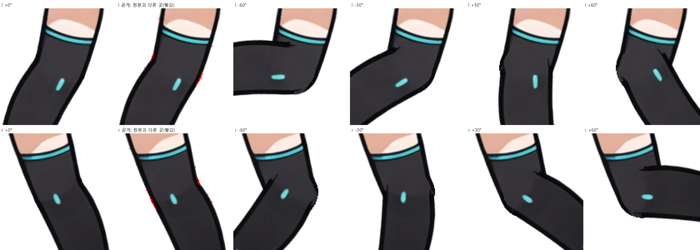
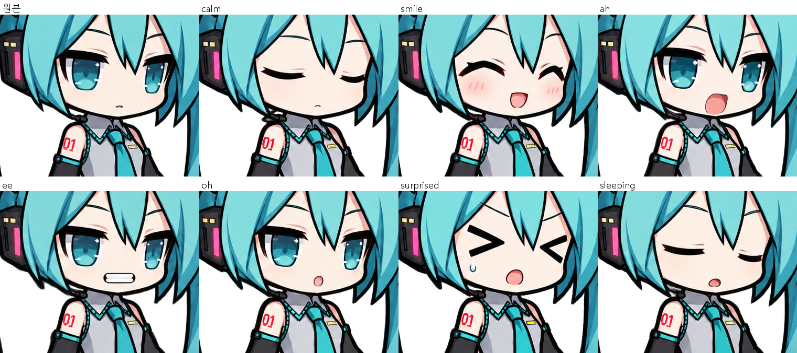
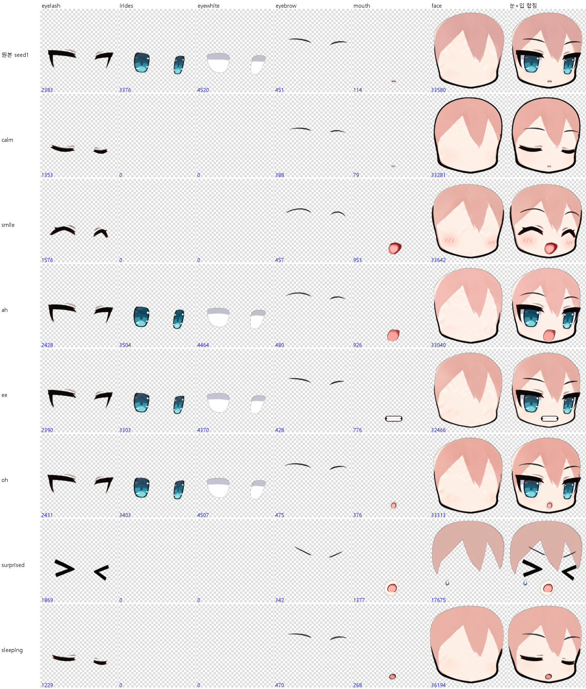

# miku 리깅 작업 확인용 (2026-11-24)

예전 seed·mix 결과는 지우고, 리깅용 분리 작업만 새로 올렸어요. (예전 내용은 git 기록에 남아 있어요.)
모든 레이어 png는 1024 정사각형 페이지 좌표라 확정본 `miku_v1` 레이어에 그대로 겹쳐 쓸 수 있어요.

## 1. 다리 무릎 나누기 — [1_legs](1_legs)
- 사용자가 그은 빨간 선에서 자름. **종아리(shin)가 앞, 허벅지(thigh)가 뒤.**
- 종아리에 둥근 관절 캡(외곽선 없음), 관절 외곽선은 `shin_*_joint_line.png`로 따로: **종아리 뼈에 붙이고, 그리는 순서는 허벅지보다 뒤.**
  → 서 있을 때는 원본과 같고, 굽히면 배경과 닿는 곳에만 외곽선이 보여요.
- 그리는 순서(앞→뒤)와 무릎 회전 중심: `legwear-*/joint.json`

## 2. 표정 편집본 — [2_expr_input](2_expr_input)
원본(`miku_chibi_sprite.png`)에서 표정만 바꾼 7장: calm, smile, ah, ee, oh, surprised, sleeping.
원본과 비교하면 얼굴 밖은 윤곽선 1~2px 흔들림뿐, 얼굴 위치 차이는 1px 안팎.

## 3. 표정 7장 See-through 결과 — [3_expr_layers](3_expr_layers)
원본 눈·입과 같은 설정(seed1, HeadGrow 3)으로 실행. 표정별 eyelash·irides·eyewhite·eyebrow·mouth·face.
눈 감은 표정은 eyelash만 나오고 눈동자·흰자는 비어 있음(맞음).

## 4. 리그용 얼굴 파츠 — [4_face_parts](4_face_parts)
`<표정>/` 폴더마다: `eyelash_l/r`, `irides_l/r`, `eyewhite_l/r`, `eyebrow_l/r`, `mouth`, (smile) `blush`, (surprised) `sweat`
- 눈은 x=540에서 좌·우 분리 (`_l` = 그림의 왼쪽). 윙크 가능.
- smile 홍조는 face 레이어에서 따로 떼어 `blush.png`.
- surprised·oh 입 둘레 살색 고리 제거 ([전후 비교](4_face_parts/mouth_clean.png)).

## 5. 공용 효과 — [5_effects](5_effects)
`sweat_drop/sweat_drop.png` (15×21, 투명) — 다른 캐릭터에도 쓰는 땀방울. `source.json`에 캐릭터별 위치.
